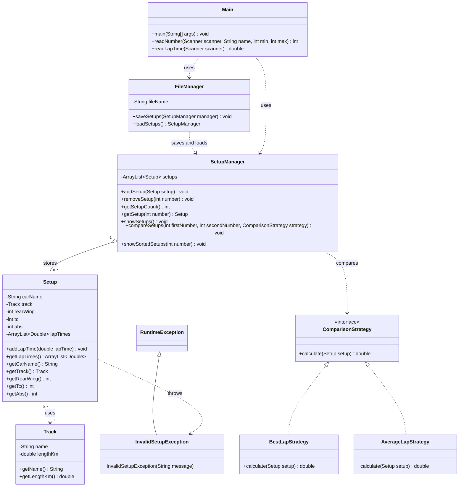

# GT3 Setup Manager - UML Class Diagram

## Design Pattern

A programban a Strategy (stratégia) tervezési mintát használom, amely a viselkedési tervezési minták közé tartozik.

A ComparisonStrategy interfész meghatározza a calculate() metódust, amelyet két osztály valósít meg:

BestLapStrategy: megkeresi a leggyorsabb köridőt.

AverageLapStrategy: kiszámítja a köridők átlagát.

A felhasználó a menüben kiválaszthatja, hogy melyik módszerrel szeretné összehasonlítani a setupokat.

A SetupManager a kiválasztott stratégia calculate() metódusát használja az összehasonlításhoz.

Ennek előnye, hogy a különböző számítási módszerek külön osztályokban találhatók, így nem kell minden módszerhez külön összehasonlító funkciót készíteni. A megoldás az interfészhasználatot és a polimorfizmust is bemutatja.

